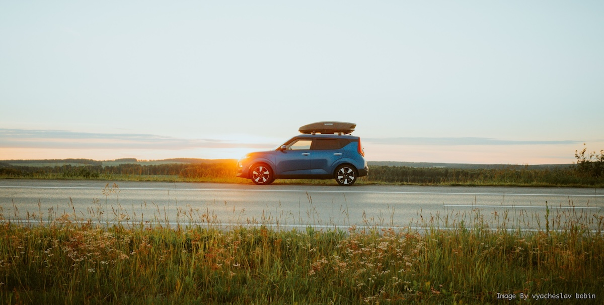
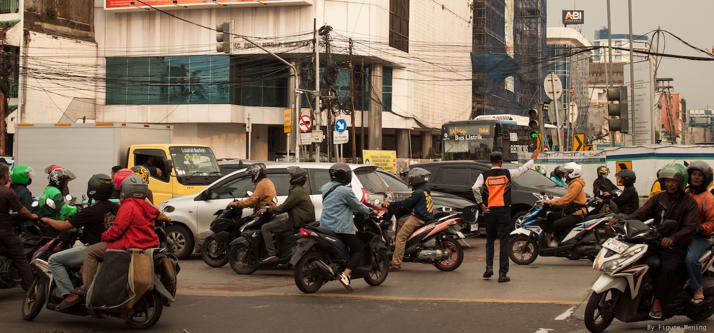
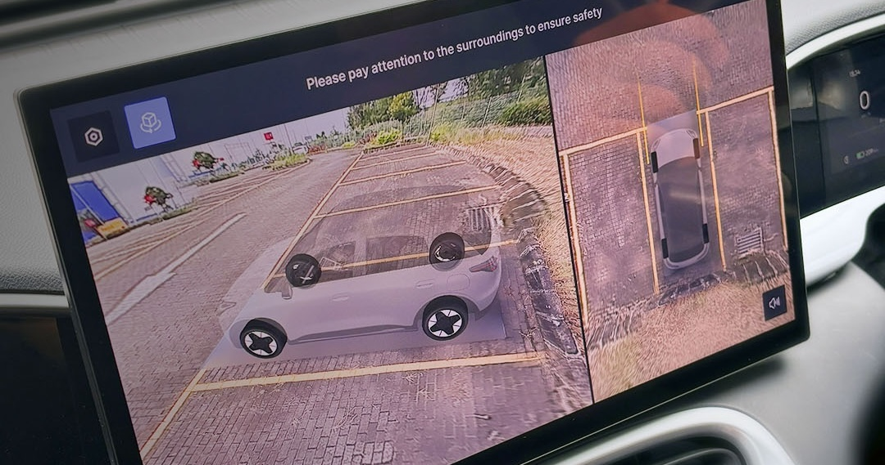

I never really liked cars, and I also never cared that much about driving. For years, a motorcycle was enough for me. Cheap, easy to park, low maintenance, done.

I spent years saying I didn't need a car. Now I'm getting one, so yeah, I guess it's time to eat my own words 😂

My wife has been complaining about going everywhere on a motorcycle. And to be fair, our traffic environment is not very friendly to pedestrians or motorbikes. Pollution, rain, heat, direct sun, all the usual stuff.

At some point, I became so irritated after being forced to inhale black smoke from some car or truck in front of me, probably manufactured before I was born, while trying hard to catch my breath. Told you, not a nice experience.

After a few of those experiences, it started becoming unbearable. I also couldn't stand the heat anymore when going to another city through interprovincial roads. GrabCar isn't exactly cheap these days either, and having to be a little chatty with the driver when you really don't want to can be exhausting.

So yeah, I learned to drive.

## Starting with anxiety

My first lesson car was a Toyota Calya.

I honestly had no opinion about the car because my brain was too busy trying not to kill anyone 😂. Steering, mirrors, road position, motorcycles appearing out of nowhere (**now I know why car drivers hate motorbikes so much**), remembering where the left side of the car actually is.

Watching other people drive makes it look stupidly easy. Then you sit behind the wheel and suddenly your brain feels like it has 18 browser tabs open at the same time. Out of memory!

After a few lessons, I tried a Honda Brio. It felt much easier because it was smaller, although maybe I was also just becoming slightly less incompetent. I don't know.

After several lessons, I somehow got my driving licence. I'm not sure if that proves that I can drive, or that the bar is quite low in our country. You know if you know 😉

Anyway, licence acquired. Problem solved, right? Nah. Now I needed a car to practice further.

## The chicken-and-egg problem

My original idea was to buy a cheap used car under Rp100 million. Practice for a few months, become less anxious, sell it, then decide later if I actually wanted a proper car.

Very reasonable.

Then I started thinking about actually buying a used car. Finding a good one, checking its condition, ownership transfer, maintenance, and eventually going through the process of selling it again.

Hmm. I could already imagine the headache. As a complete noob with basically no car knowledge, this was quite intimidating on top of learning to drive itself.

Borrowing a relative's car was another option, but somehow that made me even more anxious. Scratching my own car is one thing. Scratching someone else's car comes with free emotional damage.

In Javanese, there is a word for that: *rikuh*. It's that awkward, uncomfortable feeling when you use someone else's stuff, owe them a favor, or worry about what happens if something goes wrong. I didn't want to add that social burden on top of already being nervous about driving.

So I thought of another option: okay, rental. Then a rental company rejected me after finding out I was still a new driver. Epic moment!

Fair enough, honestly. Who wants to risk their fleet on newcomers like me? But now I had a beautiful chicken-and-egg problem: I needed more driving experience to rent a car, but I needed a car to get more driving experience. Excellent.

## Then technology poisoned me

I had already been interested in EV technology for the past 3–4 years, but mostly from the technology side. I still wasn't really a "car person."

One day, while watching driving lessons on YouTube, a video about a small EV caught my attention. It looked fun and interesting. Fortunately, there was a dealer nearby, so I went there and test drove one.

Oh boy, that was a **mistake**.

Coming from a Calya and Brio, suddenly I knew what a nicer car felt like 😂. Quiet, smooth, no gear shifting, clean interior, big center screen, cameras everywhere, sensors everywhere, ADAS. All those little tech things that I absolutely did not need to discover while trying to make a financially sensible decision.

My original requirement was basically:

> Car moves forward. Car moves backward. Cheap.

Then I saw the 540° camera. Oh well, shit.

Apparently my gateway drug into becoming interested in cars wasn't horsepower or engine sound. It was parking cameras and wondering how all those sensors and software worked behind the scenes. Classic me, huh?

As a tech enthusiast, this was the poison. I started thinking, "Actually, this would be easier to learn with. The cameras help. The sensors help. EVs are simpler to drive. I can practice anytime. It can even act as a huge power bank."

Very reasonable arguments. Definitely not lifestyle inflation. Right? Right?

So somehow my plan went from "buy a cheap used car to practice" to "I guess my first car is going to be a new EV." That escalated quite nicely 😂

## Paying with life force

Buying it still wasn't an easy decision, though.

I wrote before about how [your life force has a price tag](/posts/your-life-force-has-a-price-tag). Money is not just money. It represents time, stress, energy, and a portion of your life that you exchanged to earn it.

That's probably why I can be annoyingly reluctant to spend money on expensive things.

A car is especially difficult because financially, not owning one is obviously better. It depreciates, needs insurance, tax, maintenance, and will happily continue asking for money after you've already paid for it.

Since I had already written my own [five-question framework before spending my life force](/posts/5-questions-before-i-spend-my-life-force), I figured I should probably run this purchase through it too. Eat my own dog food, I guess.

### 1. Will I use this often?

Yes. Besides normal transportation, I need something I can use regularly to practice driving until it stops feeling like a boss fight. And unlike another random gadget that ends up sitting in a drawer after three weeks, this one would actually become part of daily life.

### 2. Will this save me time or energy?

Also yes. Less dealing with heat, rain, pollution, Grab, rentals, borrowing someone else's car, or arranging another driving lesson just because I want more practice.

It also removes a surprising amount of mental friction. Want to go somewhere? Take the car. No coordination, no asking anyone, no *rikuh*.

### 3. Will this give me a new perspective?

Probably. Learning to drive already did. I suddenly understand why cars behave differently around motorcycles, why parking spaces feel much smaller from behind the wheel, and why people complain about certain road designs.

Owning an EV also gives the tech enthusiast in me something completely new experience to explore.

### 4. Will this create more value than it costs?

This one is harder. Financially? Probably not. Not owning a car is obviously cheaper.

But convenience, independence, comfort, protection from weather and pollution, and being able to go somewhere whenever I want have value too. Apparently not everything fits nicely into a spreadsheet. Annoying.

### 5. Would I still want this if nobody knew?

Yes. In fact, I'm deliberately not telling you exactly which car it is 😂

That question is probably the easiest one for me. I don't really care whether someone thinks the car is impressive. I mostly care that it makes my life easier and gives me the freedom to practice without depending on anyone else.

So, okay, it passed my own test. Not because buying a car suddenly became a financially optimal decision. It didn't. But at least I knew what I was paying for.

Money is also supposed to be useful. In this case, I'm buying convenience. I don't need to borrow someone's car, find a rental, or schedule another driving lesson just because I want to practice. I can simply take the car and drive.

Maybe that's a reasonable use of some accumulated life force. At least that's what I told myself before signing the SPK 😂

I still don't think I'm a car person. I still get anxious when driving, and I'm obviously still learning. But at least now I can be anxious inside my own car.

**Small progress is still progress.**
