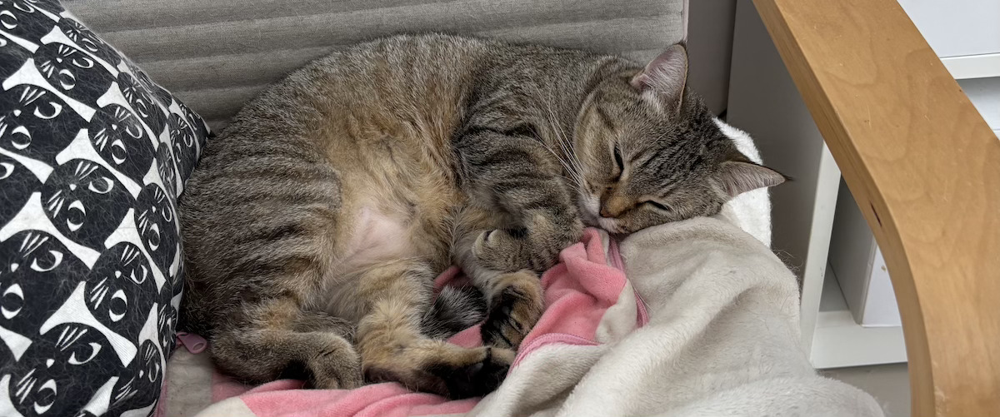

I think sleep is probably one of the most underrated habits people often overlook, despite its enormous benefits. After years of experimenting with different sleeping habits, I thought I'd share what works for me most of the time.

One thing I've noticed is how much my sleep affects practically everything else in my life. My mood, energy, concentration, and even how I handle stressful situations. When I don't get enough sleep, everything feels a little harder. I become easily irritated, more anxious, and sometimes struggle to concentrate on even the simplest things.

As someone who spends most of his working hours staring at computer screens, solving problems, and occasionally dealing with stressful situations, recovery and decompression have become increasingly important to me.

And no, I'm not talking about some fancy biohacking routine, expensive sleeping gadgets, or whatever supplement is currently trending on social media.

Just a few boring habits I've been practicing for years.

Sleep is one of those things I refuse to compromise on unless absolutely necessary.

## Keeping My Body Clock Consistent

I generally go to bed around 9 PM and wake up around 5 AM. Yep, even on weekends.

Boring, I know. While some people are just getting ready to go out, I'm probably already preparing to sleep. Haha.

But here's the interesting part. After following the same schedule for years, my body seems to know exactly when it's time to sleep. I don't even need to look at the clock. When I start feeling unusually sleepy, chances are it's already approaching 9 PM.

And the best part? I can often wake up naturally, feeling refreshed, without even needing an alarm.

Our bodies have an internal biological clock called the *circadian rhythm*, which helps regulate when we feel awake and sleepy. Keeping a consistent schedule helps our bodies maintain that rhythm.

My morning running habit fits naturally into this routine too. Getting outside early exposes me to natural sunlight, which helps regulate the sleep-wake cycle. So in a way, my morning run isn't just about maintaining physical fitness. It also supports my sleeping habits.

Of course, it doesn't mean I follow this schedule religiously every single day. Sometimes life happens. But having a consistent baseline makes it much easier to return to my normal routine.

## What to Avoid

First, food.

I try to leave enough time between dinner and bedtime. For example, if I'm planning to sleep at 9 PM, having dinner around 5 or 6 PM works pretty well for me.

If dinner happens a little later, I usually avoid eating a particularly heavy meal. Something light, like warm oatmeal, might be enough. Just don't go to bed starving either. I've tried that before, and it's not particularly pleasant.

Another thing is drinking too much water right before bedtime.

Sounds trivial, right? But imagine finally falling into a deep sleep, only to wake up at midnight because your bladder is screaming for attention.

So I try to stay properly hydrated throughout the day and avoid drinking excessive amounts just before bed. It's a matter of finding the right balance.

And then there's caffeine.

I normally don't drink much caffeine, but if you do, I'd suggest avoiding it for at least 6–8 hours before bedtime, possibly longer if you're sensitive to it.

I still remember one particularly stupid moment when I decided to drink a strong matcha just two or three hours before bed.

Guess what happened?

I ended up staring at the ceiling until 3 AM, wondering why my brain suddenly had so much energy.

Super nice, I accidentally sabotaged my own sleep. Haha 🤣.

Instead, I sometimes enjoy sipping a warm cup of chamomile tea before bedtime. I find it relaxing, although I'm not entirely sure whether it's the chamomile itself or simply the calming ritual of drinking something warm.

Either way, it works for me.

## Creating the Right Environment

I've also become increasingly conscious of my sleeping environment.

Nothing particularly sophisticated. I prefer my bedroom to be dark, quiet, and comfortably cool. That's pretty much it.

One thing I don't cheap out on, though, is my bed.

I've actually mentioned this in [another post](/posts/5-questions-before-i-spend-my-life-force), when I explained how I justified spending more money on a comfortable mattress.

Think about it. We spend roughly one-third of our lives sleeping. If there's one place where spending a little extra for comfort makes sense, surely it's the thing we lie on for seven or eight hours every night.

I also enjoy taking a warm shower before bedtime. There's something incredibly comforting about stepping out of a warm shower and entering a cool bedroom afterward.

Seriously, it feels so damn good.

Another habit I've been trying to maintain is reducing screen exposure before bedtime.

After spending eight or more hours staring at computer monitors, do I really need another hour of scrolling through social media, reading random arguments, or watching videos that I probably won't remember tomorrow?

Probably not.

Bright light in the evening can interfere with our natural sleep-wake cycle, and stimulating content doesn't exactly help our minds settle down either.

Sometimes I just put my phone away and read a book instead. Nothing exciting, but that's precisely the point.

## Supplements

One supplement I've incorporated into my nighttime routine is magnesium glycinate.

Magnesium is an essential mineral involved in hundreds of biological processes, including normal muscle and nervous system function.

There are different forms of magnesium available, such as citrate, oxide, and glycinate. Glycinate caught my attention because it's generally well tolerated and is often suggested for nighttime use. Whether it's actually superior to other forms for improving sleep is another question.

To be clear, I don't consider magnesium a sleeping pill, nor do I think everyone needs to take it. The scientific evidence for magnesium supplementation improving sleep is still mixed.

But I've noticed a couple of interesting things from my own experience.

First, my dreams seem noticeably more vivid and realistic whenever I take magnesium glycinate. Sometimes they feel so real that I can still remember the details after waking up.

When I skip it, I don't seem to experience the same intensity as often.

And perhaps more importantly, I notice that I tend to wake up less frequently in the middle of the night when I take it.

Does that mean magnesium directly causes these changes? I honestly don't know. There might be other factors involved, and I'm certainly not going to pretend my personal observation is scientific proof.

It could even be a coincidence. Who knows?

But it's something I've noticed repeatedly, and that's why I've continued including it in my routine.

Of course, supplementation isn't a substitute for proper sleeping habits. You can't expect a capsule to magically fix your sleep if you're drinking caffeine at night, scrolling through your phone until midnight, and constantly changing your bedtime.

I still consider consistency, environment, and sufficient sleep far more important than any supplement.

## Sleep Is Not Wasted Time

One thing I find interesting is how easily people underestimate sleep simply because it doesn't produce anything immediately visible.

We often glorify people who sacrifice their sleep to work longer, study harder, or chase whatever goals they're pursuing.

You've probably heard those motivational stories about successful people who supposedly sleep only four hours a night.

Good for them, I guess. But that's certainly not something I aspire to.

To me, consistently sacrificing sleep is a little like taking on debt. You might not notice the consequences immediately, but sooner or later, the accumulated sleep deprivation starts catching up with you.

When you're younger, perhaps you feel like you can get away with it. Pulling an all-nighter, sleeping a few hours, and somehow still functioning the next morning.

But just because you can tolerate it doesn't mean there aren't consequences. And as you get older, you might discover that recovering from a terrible night's sleep isn't quite as effortless as it used to be.

Of course, I don't always sleep perfectly either.

Sometimes, despite following all these habits, my mind simply refuses to cooperate.

I might be lying comfortably in bed, ready to sleep, when my brain suddenly decides it's the perfect time to replay some embarrassing moment at work.

Or that stupid thing I said several years ago that absolutely nobody remembers anymore.

Seriously, brain? Now?

Haha. It's annoying, but that's life.

When that happens, I try not to force myself to sleep. Sometimes getting out of bed for a while, reading a book, or doing something relaxing away from screens helps more than lying there getting increasingly frustrated.

There will always be nights when things don't go according to plan. I'm not trying to achieve perfect sleep every single night. That would probably become another unnecessary source of stress.

I just want to give my body the best possible conditions to recover from whatever happened during the day.

And perhaps that's what I've come to appreciate most about sleep. It's not wasted time. It's not something I should sacrifice just to squeeze another hour of productivity out of my day.

After all, what's the point of working hard to build a better life if I'm constantly too exhausted to enjoy it?

At the end of the day, a good night's sleep isn't something I take for granted.

**It's a basic necessity, and one of the simplest ways I can take care of myself.**

_P.S. Let me know if you want to see more pictures of my cats. Haha 😜._
